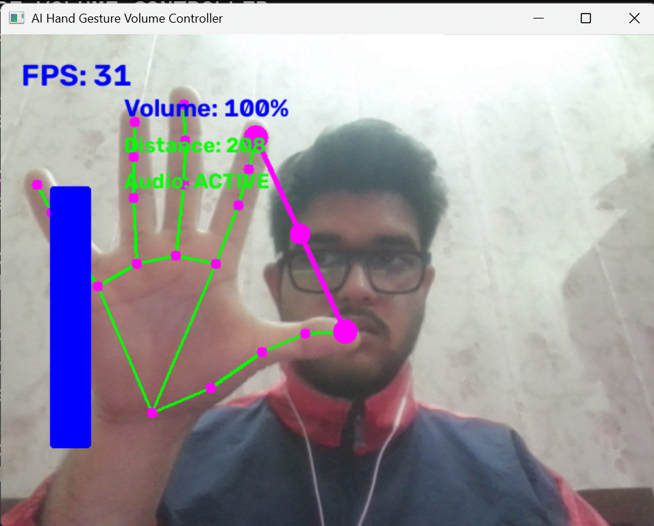

 <div align="center">

# 🎚️ AI Hand Gesture Volume Controller

*A real-time, touchless system for controlling Windows system volume using hand gestures, built with Python, OpenCV, and MediaPipe.*


</div>

---

# 📌 Project Overview

The **AI Hand Gesture Volume Controller** is a computer vision-based application that allows users to control their Windows system volume through hand gestures.

Using a webcam, the application detects hand landmarks in real time and calculates the distance between the thumb tip and index finger tip.

This distance is mapped to the system volume level, allowing users to increase or decrease the volume by changing the distance between their fingers.

The project demonstrates:

- Real-time hand detection and tracking
- Computer vision using OpenCV
- Hand landmark detection using MediaPipe Tasks
- Gesture-based interaction
- Windows system audio control
- Volume smoothing for stable interaction
- Gesture-based mute and unmute functionality

---

# 🏗️ System Architecture

```text
              Webcam Input
                   │
                   ▼
          OpenCV Frame Capture
                   │
                   ▼
          MediaPipe Hand Tracking
                   │
                   ▼
          Hand Landmark Detection
                   │
                   ▼
       Extract Thumb and Index Tips
                   │
                   ▼
          Calculate Finger Distance
                   │
                   ▼
          Distance-to-Volume Mapping
                   │
                   ▼
            Volume Smoothing
                   │
                   ▼
          PyCaw Audio Controller
                   │
                   ▼
          Windows System Volume
```

---

# ✋ Hand Tracking System

The application uses **MediaPipe Hand Landmarker** to identify and track hand landmarks.

### Features

- Real-time hand detection
- Detection of 21 hand landmarks
- Tracking of thumb and index fingertips
- Visual representation of hand connections
- Webcam-based gesture recognition

### Important Landmarks

| Landmark | Index |
|---|---:|
| Thumb Tip | 4 |
| Index Finger Tip | 8 |

These landmarks are used to calculate the distance between the thumb and index finger.

---

# 🎚️ Volume Control System

The application converts the distance between the thumb and index finger into a corresponding system volume percentage.

### Gesture Mapping

- Fingers close together → Lower volume
- Fingers farther apart → Higher volume
- Fingers brought sufficiently close → Mute
- Fingers separated beyond the unmute threshold → Unmute

### Distance Mapping

The application uses distance-based interpolation to map finger movement to the volume range.

```text
Finger Distance
       │
       ▼
Distance Mapping
       │
       ▼
Volume Percentage (0–100%)
       │
       ▼
Volume Smoothing
       │
       ▼
Windows Audio Output
```

### Volume Smoothing

An exponential smoothing technique is used to reduce sudden volume fluctuations and provide more stable control.

### Mute and Unmute

The application uses separate mute and unmute distance thresholds to avoid rapid switching when the fingers are close to the threshold.

---

# ⚙️ Backend Audio Control

The project uses **PyCaw** to interact with the Windows audio system.

### Features

- Access Windows master audio volume
- Set volume using scalar values
- Retrieve the current volume level
- Mute and unmute system audio
- Display current volume percentage

---

# 📁 Project Structure

```text
VOLUME-HAND-TRACKING/
│
├── models/
│   └── hand_landmarker.task       # MediaPipe hand landmark model
│
├── handtrackingmodule.py          # Hand detection and landmark tracking
├── volumehandcontroller.py        # Gesture-based volume control
├── main.py                        # Application entry point
├── test_volume.py                 # Audio volume testing
│
├── requirements.txt               # Python dependencies
├── .gitignore                     # Git ignored files
├── README.md                      # Project documentation
└── LICENSE                        # MIT License
```

---

# 🛠️ Technologies Used

| Technology | Purpose |
|---|---|
| Python | Core programming language |
| OpenCV | Webcam access and image processing |
| MediaPipe Tasks | Hand landmark detection |
| NumPy | Distance calculation and interpolation |
| PyCaw | Windows system volume control |
| COM / PyWin32 dependencies | Windows audio interface support |

---

# 💻 Installation and Setup

### Prerequisites

- Windows operating system
- Python 3.14 or a compatible Python version
- Webcam
- Git
- Working audio output device

### 1. Clone the Repository

```bash
git clone https://github.com/PranavChamoli06/VOLUME-HAND-TRACKING.git
```

### 2. Navigate to the Project Directory

```bash
cd VOLUME-HAND-TRACKING
```

### 3. Create a Virtual Environment

```bash
python -m venv venv
```

### 4. Activate the Virtual Environment

```bash
venv\Scripts\activate
```

### 5. Install Dependencies

```bash
pip install -r requirements.txt
```

### 6. Verify the Model File

Ensure the following model file exists:

```text
models/hand_landmarker.task
```

The application uses this model for hand landmark detection.

---

# ▶️ Running the Application

Start the application using:

```bash
python main.py
```

The application will:

1. Initialize the webcam.
2. Load the MediaPipe hand landmark model.
3. Detect and track hand landmarks.
4. Calculate the distance between the thumb and index finger.
5. Convert the distance into a volume percentage.
6. Update Windows system volume.
7. Display the live camera feed and volume information.

Press **Q** to exit the application.

---

# 🧠 How It Works

### Step 1: Webcam Capture

OpenCV captures live frames from the webcam.

### Step 2: Hand Detection

MediaPipe detects the hand and identifies its 21 landmarks.

### Step 3: Landmark Extraction

The application extracts the coordinates of:

- Thumb tip (Landmark 4)
- Index fingertip (Landmark 8)

### Step 4: Distance Calculation

Euclidean distance is calculated between the two fingertips.

\[
d=\sqrt{(x_2-x_1)^2+(y_2-y_1)^2}
\]

### Step 5: Volume Mapping

The calculated distance is mapped to a volume percentage between 0% and 100%.

### Step 6: Volume Adjustment

PyCaw updates the Windows master volume using the calculated scalar value.

### Step 7: Visual Feedback

The application displays:

- Hand landmarks
- Distance between fingertips
- Volume percentage
- Volume level indicator
- Mute / active status
- Frames per second (FPS)

---

# 🎯 Key Features

- Real-time hand tracking
- Touchless volume control
- Webcam-based gesture recognition
- 21-point hand landmark detection
- Dynamic volume adjustment
- Exponential volume smoothing
- Gesture-based mute and unmute
- Live volume visualization
- FPS monitoring
- Proper camera and resource cleanup

---

# 🔮 Future Enhancements

- Graphical user interface (GUI)
- Customizable gesture sensitivity
- Support for additional hand gestures
- Multi-hand interaction
- Gesture-based media playback controls
- Cross-platform audio control
- User-configurable volume ranges

---

# 📸 Screenshots

### Live Hand Tracking


### Gesture-Based Volume Control



---

# ⚠️ Important Notes

- The application currently targets Windows because it uses PyCaw for audio control.
- A working webcam is required.
- The MediaPipe model file must be available in the `models` directory.
- Ensure that the required Python dependencies are installed before running the application.

---

# 👨‍💻 Author

Developed by **Pranav Chamoli**

GitHub: [PranavChamoli06](https://github.com/PranavChamoli06)

Project Repository: [VOLUME-HAND-TRACKING](https://github.com/PranavChamoli06/VOLUME-HAND-TRACKING)

---

# 📄 License

This project is licensed under the MIT License. See the [LICENSE](LICENSE) file for details.
